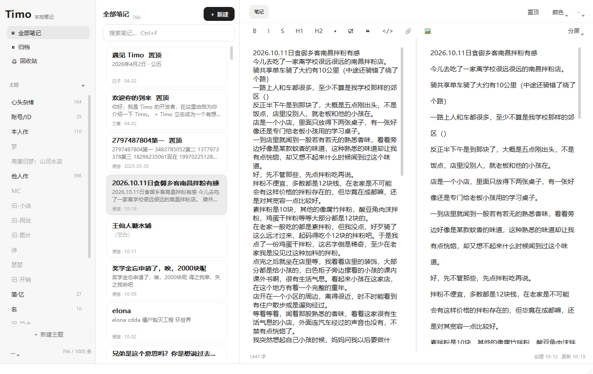
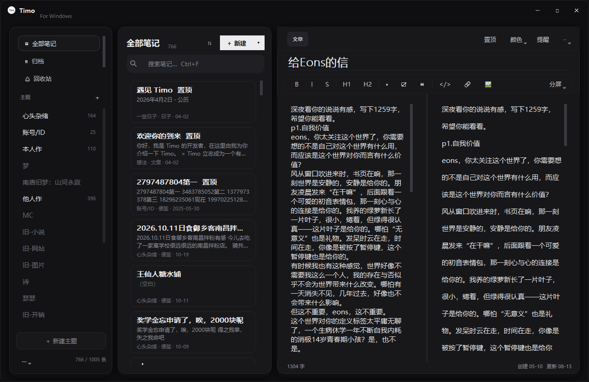
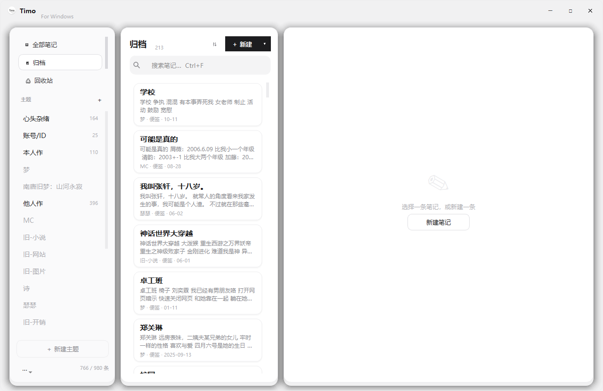

# Timo For Windows

把 Android 上的 [Timo笔记](https://timo.idik.net/) 搬到 Windows 的本地笔记软件：**数据全在本机，不需要账号，不联网**。
直接导入手机 App 导出的 ZIP，改完还能再导出回去。



深色模式（数据与设置 → 外观 → 深色，也可跟随系统）：



> 非官方项目，与 Timo 官方无关。本仓库只处理用户自己导出的数据，不包含、也不分发 Timo 的应用本体。

## 下载

安装包约 104 MB，解开后约 128 MB，双击就能用，不写注册表。
**Release 里放的就是这个 `.exe`**：下载 → 双击 → 选位置 → 解压 → 自动打开并删掉安装包，之后用文件夹里的 `Timo For Windows.exe`。

到 [Releases](../../releases/latest) 下载 **`Timo For Windows 安装包.exe`**。

要求：Windows 10 / 11 64 位。

## 怎么用（便携版）

### 1. 解包

双击下载的 `Timo For Windows 安装包.exe`：

1. 弹出小窗口，显示要解压到的位置，默认是安装包旁边新建的 `Timo For Windows` 文件夹；
2. 想换地方就点 **更改…** 选一个目录（会在里面再建一个 `Timo For Windows`）；
3. 点 **解压到这里**，等进度条走完。

解压完成后：程序会自动打开，**安装包自己删除**，留下的就是一个可以直接用的文件夹：

```
Timo For Windows/
├── Timo For Windows.exe   ← 双击这个启动
├── _internal/             ← 运行需要的 Qt 等 dll，别删
└── Data/                  ← 你的笔记数据
```

整个过程不写注册表、不装服务、不出现命令行黑框。

> **第一次运行会被 Windows 拦一下。** 这个安装包没有买代码签名证书，Windows SmartScreen 会提示「Windows 已保护你的电脑」——点 **更多信息** → **仍要运行** 就行。少数杀毒软件也会对「自己解压自己」的安装包报警，可以把它加进白名单。

### 2. 第一次打开

双击 `Timo For Windows.exe`，会问你要不要导入手机上的数据：

1. 打开手机上的 Timo笔记 → 设置 → 导出可读副本，得到 `Timo_Export_xxxx.zip`；
2. 在欢迎页点 **导入 Timo 导出包（.zip）**，选中那个 ZIP；
3. 等几秒，主题、笔记、图片、账号就都进来了。

也可以跳过欢迎页，之后从侧栏底部的 `⋯` 菜单导入；把 ZIP 拖到主窗口里、或者拖到 `Timo For Windows.exe` 图标上，都能导入。

库里已经有笔记时，导入会问一句：

- **合并导入**：保留现在的笔记，只把包里没有的新笔记加进来（正文不会被覆盖，适合手机又记了一些再导一次）；
- **替换导入**：清空当前库整体替换，动手前会自动备份到 `Data/backup/`。

### 3. 搬家 / 备份

所有东西都在这个文件夹里：

```
Data/
├── library.json      # 主题与笔记元数据
├── notes/*.md        # 每条笔记的正文（Markdown）
└── attachments/      # 图片等附件原件
```

要换电脑或备份，直接复制整个 `Timo For Windows` 文件夹即可；想回手机上用，从 `⋯` 菜单 **导出为 Timo ZIP**，再把 ZIP 导回手机。

### 4. 托盘

- 点窗口右上角的 **✕** 不会退出，而是收进系统托盘（右下角时间旁边）；
- **单击托盘图标** 重新打开窗口；
- **右键托盘图标**：打开 Timo For Windows / 新建笔记 / 打开数据文件夹 / 退出。

## 功能

| 功能 | 说明 |
| --- | --- |
| 六种笔记类型 | 便签、文章、图库、账号、链接、日子，各自保留 Timo 的展示样式；「＋ 新建」右侧的 `▾` 可直接选类型 |
| Markdown | 编辑 + 实时预览，支持粘贴图片、拖入图片文件 |
| 待办清单 | `- [ ]` 在预览里是可点的方框，点一下就打勾（直接写回正文） |
| 图库 | 批量添加图片、拖拽调整顺序、双击看大图；列表里能直接看到封面 |
| 整理 | 全库搜索（列表卡片与预览都会标出命中词）、置顶、8 档灰阶颜色标记、归档、回收站（可清空）、跨主题移动；列表上按 `Delete` 移到回收站 |
| 拖动 | 把笔记卡片拖到左侧任一主题上，直接移动过去（多选后可一起拖）；把 `.md` / `.txt` 文件拖进窗口会在当前主题新建一条笔记 |
| 导出 | 单条「复制为 Markdown」/「导出为 Markdown…」、「导出为 PDF…」；整个库可「导出为 Markdown 文件夹…」（按主题成目录，图片放 `attachments/`） |
| 清理 | 数据菜单「清理未使用的图片…」删掉删了引用后残留的附件 |
| 提醒 | 编辑器右上角「提醒」可设到点提醒（一小时后 / 今天 20:00 / 明天 9:00 / 自定义），到点从托盘弹出；卡片与顶部按钮会标出提醒时间 |
| 主题 | 新建 / 改名 / 删除 / 拖拽排序 / 锁定（锁住后不能改名和删除）；删主题时里面的笔记一起进回收站，主题本身可在「数据与设置 → 已删除的主题…」里找回；归档主题在侧栏灰显 |
| 导入导出 | 与 Timo 官方 ZIP 结构兼容，可往返；已有数据时可选合并或替换 |
| 深色模式 | ⋯ → 「外观」：浅色 / 深色 / 跟随系统，选择会记住 |
| 自动保存 | 停顿 0.7 秒写盘，关窗时再存一次 |
| 自动备份 | 每次启动最多每天备份一次正文与库结构到 `Data/backup/`，保留最近 7 份，数据菜单可手动备份或回滚 |

常用快捷键：`Ctrl+N` 新建笔记、`Ctrl+Shift+N` 新建主题、`Ctrl+F` 搜索（光标在正文里时变成在本文中查找，`Esc` 关闭；在搜索框里按 `Esc` 清空搜索）、`Ctrl+S` 保存、`Ctrl+E` 切换编辑/分屏/预览。

正文里还有：`Ctrl+B` 粗体、`Ctrl+I` 斜体、`Ctrl+K` 链接、`Ctrl+Shift+T` 待办、`Ctrl+Shift+1/2` 一/二级标题。

### 界面

三栏布局，左栏主题与导航，中栏笔记卡片，右栏按类型切换的编辑器：



## 已知说明

- 密码以明文保存在 `library.json`（与 Timo 导出的 `accounts.csv` 一致）。程序不加密、不联网，别把数据目录发给别人。
- 回收站默认**不会**自动清理。想让超过 N 天的笔记在启动时自动清掉，把 `Data/settings.json` 里的 `trash_days` 设成天数（默认 0 = 关闭）。
- 手机端的云同步、桌面小组件没有移植；提醒是本地功能，Timo 导出包不带提醒字段，所以**导出回手机时提醒会丢**，其余内容不受影响。
- 首次导入 1000 条笔记约需 5 秒。
- 如果把程序放在 U 盘里用，`Data/` 会跟着 U 盘走；U 盘拔掉前先退出程序。

## 从源码运行

```bat
pip install PyQt5 markdown
python run.py
```

打便携版（主程序 + 自解压安装包）：

```bat
python tools/make-portable.py
```

产物：

- `dist/Timo For Windows/Timo For Windows.exe` —— 解压后的程序本体
- `dist/Timo For Windows 安装包.exe` —— 用来分发的单文件安装包

## 开发

- 分支模型：`snapshot` 是日常工作分支，`master` 只接受 `git merge --ff-only snapshot`，发版时打 tag 并发布 Release。
- 每次改动追加一条到 `PENDING-CHANGES.md`，发版时汇总进 `CHANGELOG.md`。

## 许可

[MIT](LICENSE)
